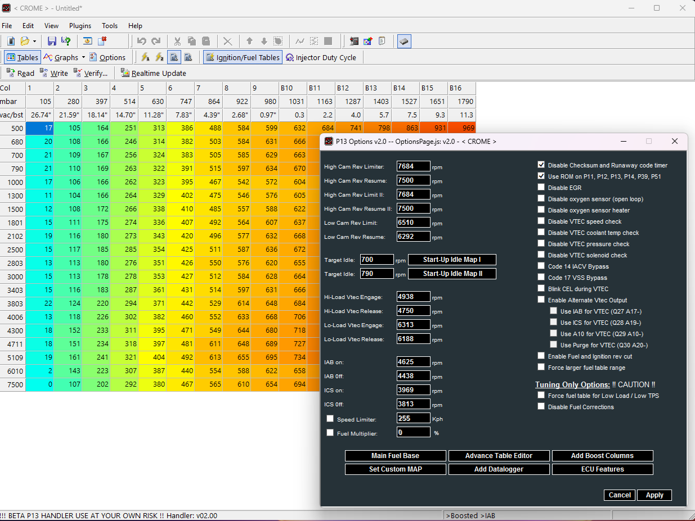

# CROME_P13_Handler
An updated ROM handler for John Cui's CROME to edit P11, P12, P13, P14, P39, P51 OBD-I Honda ECUs
Features:
    - More accurate fuel table support
    - Full speed datalogger 
    - Alternate VTEC outputs
    - VTEC on non VTEC ECUs
    - IAB / ICS control
    - extended (boost) tables
    - Close loop bypass
    - EGR Disable
    - Knock disable
    - custom MAP sensors
    - expanded fuel adjustment range
    - fuel multipler
    - Compatibility accross multiple 66911 base ECUs
    - ECU Feature and RP Jumper Control
    - Basic viewing and editing of nearly ALL ROM tables
    - and more.

